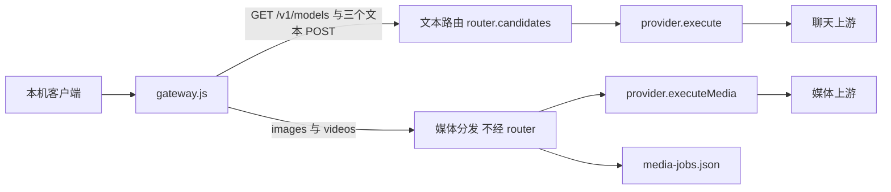
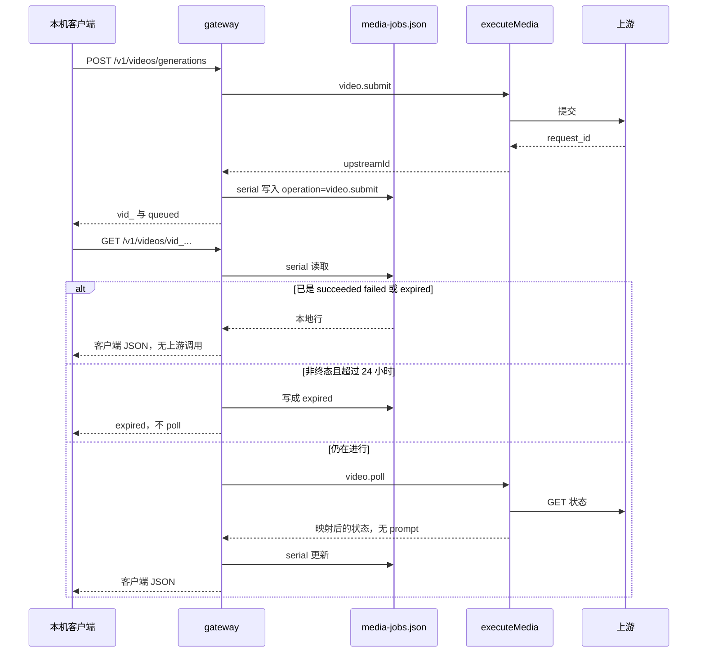

# Daylight 图像与视频生成反向代理

实现以 [media-proxy.md](media-proxy.md) 为准，范围是 Grok 图像与视频、Codex 图像、AGY 上的 Gemini 图像。本文里把 Grok 拆成多段、或要求单独 API Key 的段落不再执行。

| 项 | 值 |
| --- | --- |
| 作者 | 待填写 |
| 日期 | 2026-10-28 |
| 状态 | Draft |
| 读者 | 熟悉 `proxy/` 的工程师 |
| 相关文档 | `docs/proxy-architecture.md`、`docs/reverse-proxy.md` |

> **更正（2026-10-29）**：Qoder 部分已被 [qoder-media.md](qoder-media.md) 取代。图像上游模型是 `ge3i`（对外 `qwen-image-3.0`），响应是 data URL，只支持 `b64_json`；视频内层是 `{model:'wan30', prompt, seconds:'5'（字符串）, size}`；`sessionId` 必须是非空 UUID，空串会返回 500；视频结果是约 30 天有效的 `video_url`，实测约 158 秒完成；请求用 `application/json`。本文中 Qoder 的 PR 拆分、`unverified` 状态和“需要手动探针”的说法不再适用。

本文只做设计，不实现代码。主目标是把 Grok Imagine 的图像和视频接进现有本机反向代理。Codex、AGY、Qoder、GitHub Copilot 的结论一并写明。标识符、路径和 API 字段保持英文。

## Overview

文本中转已经固定为：客户端 → `proxy/gateway.js` → `proxy/shared/router.js` → 来源 `execute()` → 上游 → `proxy/shared/relay.js`。这条链路只服务 Chat、Responses 和 Messages。图像输入（视觉）已在 `proxy/shared/protocol.js` 里跨协议转换；AI 面板粘贴图是 `core/ai-images.js` 与 `ai/images.mjs` 的聊天附件。两者都不是图像或视频**输出**。

媒体是与文本并列的平面。客户端仍只访问 `127.0.0.1`，沿用 gateway 的 Host、无 Origin、Bearer / `x-api-key` 检查。新入口是四条路由：`POST /v1/images/generations`、`POST /v1/images/edits`、`POST /v1/videos/generations`、`GET /v1/videos/{id}`。视频立即返回本地 job id。代理不把 HTTP 请求挂起数分钟，也不把视频字节读进内存。

Grok 网页上的照片和视频额度属于同一账号的订阅。Daylight 已有的 OIDC 令牌打 `https://cli-chat-proxy.grok.com/v1` 的 `/images/generations`、`/images/edits` 和 `/videos/generations`，扣的就是这份额度。`https://api.x.ai/v1` 是预付费接口，订阅账号没有预付余额时会返回 `personal-team-blocked:spending-limit`，不走那条。不抓 grok.com 的 `sso` cookie。Qoder 复用现有 COSY 会话，但不调用 `QoderHttp.signedInference`，也不复用聊天 `protocol.js`。Codex 与 AGY 在各自的启用 PR 之前保持「未提供」。Copilot 明确显示「未提供」。媒体失败不跨来源重试。

PR1 里每个来源的 `media.status` 都是 `unavailable`。后面的 PR 在 Grok 已登录时把图像和视频改成 `ready`，未登录则沿用聊天的登录错误。Qoder 先改成 `unverified`。终态表和 PR1 表分开，见「来源能力」。

## Background & Motivation

### 当前文本平面

`proxy/gateway.js` 只注册三个 POST 适配器和 `GET /v1/models`：

- 推理正文上限 `inferenceBodyLimit = 32_000_000` 字节。超限返回 413，并先 drain。
- `protocolFor()`（`proxy/shared/contracts.js`）只认识 `/chat/completions`、`/responses`、`/messages`。
- 只有 `req.method === 'POST' && protocolFor(route)` 时才创建 `RequestTrace`。`observe` 今天无条件调用 `trace.observe`。
- `createProxyService` 把这一个 gateway 挂到 `http.createServer`。Pi 的 base URL 是 `http://127.0.0.1:{port}/v1`。
- `cli/pi-config.js` 的 `getCatalog` 消费 `router.listModels()` / `router.cachedModels()`。写进该目录的模型会被当成聊天模型。
- `RequestRecords` 的元数据允许列表是 `request-records.js` 里的闭集 `metadata`。不在数组里的键会被丢掉。写盘用 `serial()`。
- `writeJson` 本身只保证一次替换是原子的，不保证读-改-写。目录 `0700`，文件 `0600`。

来源边界：`shared/` 不导入来源目录。用量在 `{dataDir}/qoder/usage.json`，不保存 prompt、工具参数或凭据。

`createProviders` 里 Qoder 的 `transport()` 用 `headerDeadline(options.signal, options.signal ? 300000 : 30000)` 包住 fetch。`headerDeadline` 只限制等到响应头的时间；`settle()` 在 fetch 返回（响应头已到）后清掉定时器。没传入 `signal` 时，这条包装是 30 秒，不是媒体设计里的 180 秒或 45 秒。

### 为什么不能沿用聊天执行

| 事实 | 位置 | 对媒体的含义 |
| --- | --- | --- |
| Grok 文本固定打到 `https://cli-chat-proxy.grok.com/v1`，401 会刷新 OIDC | `proxy/grok/provider.js` 的 `call()` | 媒体复用同一令牌和同一主机。`call()` 对 POST 发送 `Accept: text/event-stream`，媒体要 `application/json`，所以另写一个 JSON 方法，刷新逻辑仍走 `auth.credential()` |
| Grok 目录只保留 `api_backend === 'responses'`；`supports_image_in` 是视觉输入 | `proxy/grok/models.js` | Imagine 模型不能塞进 `parseModels` |
| Codex `forward()` 用固定拒绝列表挡住 `image_generation` 等托管工具，原文「ChatGPT 套餐授权不支持此托管工具」。原生 Responses 路径 `convertRequest` 在 `from === to` 时原样克隆，并不按允许列表删字段 | `proxy/codex/provider.js`、`proxy/shared/protocol.js` | 文本路径的拒绝必须留下。媒体不能模仿这段 denylist |
| 跨协议转换才有允许列表 `allowed`，未知键 `invalid` | `convertRequest`，`from !== to` | 媒体允许列表按这条更严的规则做，但是来源自己的列表 |
| AGY 生成打到 `v1internal:streamGenerateContent`；`supportsImages` 写入 `isVL` | `proxy/agy/provider.js`、`models.js` | 出图不能走现有 SSE 编译器 |
| Qoder 聊天 POST 是 `signedInference`：`accept: text/event-stream`、`content-type: text/plain;charset=UTF-8`、`x-model-key`、`cosy-scene: assistant`、`cosy-business-type: agent` | `proxy/qoder/transport.js` | 媒体 JSON 不能调用这个方法 |
| `signedPathOf` 只在路径以 `/algo` 开头时剥掉前缀 | 同文件 | 媒体路径没有 `/algo`，签名路径就是原路径 |
| Copilot 的 `supports.vision` 是输入 | `proxy/copilot/models.js` | 没有生成能力 |
| 文本路由会在 401/403/404/408/429/5xx 上换来源 | `retryableRouteError` | 媒体不进入 `router.candidates` |
| 登出只 `sourceState.invalidate` 和 `router.invalidateSource` | `proxy/management.js` 的 `auth()` | 删 job 必须改这个函数，并在调用 `logout()` 之前读出账号键 |
| Qoder 的 `identityKey` 是 `accounts.current.id`，即 `acc_${uid}` | `proxy/qoder/provider.js`、`proxy/qoder/auth.js` | job 的 account 用这个 id，不用裸 `uid` |
| Codex / AGY 的 `auth.identity` 是 `OAuthAccount.sessionIdentity`：`sha256(JSON.stringify([id, account.id, clientId]))` | `proxy/shared/oauth-account.js` | 不是 access token，也不是 `account.id` 本身 |
| Keychain 服务名 `local.daylight.proxy`。Grok OIDC 的 account 是 `grok-oauth` | `native/Credentials.swift`、`oauth-account.js` | 媒体不新增 Keychain 项。任务账号键用 `auth.identity`，OIDC 登出时删除 |
| `key/rotate` 要求代理停止，因为换的是 gateway 进程内的客户端 Key | `proxy/service.js` | Imagine Key 不是这把 Key，不能复用这条 409 |

`readUpstreamError` 最多读 16384 字节，并且 1000 ms 到时就停。`Error.message` 不含上游正文。没有识别出 `reason` 的 403 在 `upstreamError` 里仍是 `retryable`。媒体轮询不能靠这个默认值。

### 各来源证据

#### Grok Imagine

官方说明（2026-10-08 至 2026-10-10 的文档页；本环境直接打开 `docs.x.ai` 会被拦截，字段以下列已检索摘录为准）：

- 图像生成：`POST https://api.x.ai/v1/images/generations`，模型 `grok-imagine-image-2.0`。约 $0.04/张，与分辨率无关。编辑对输入图和输出图分别计费。
- 图像编辑：`POST https://api.x.ai/v1/images/edits`。一张图用 `image`，最多五张用 `images`。元素形状是 `{ "type": "image_url", "url" }`。公开 URL 或 base64 data URI。不接受 OpenAI SDK 的 multipart。本设计不接受 `file_id`。
- 视频：`POST https://api.x.ai/v1/videos/generations` 返回 `request_id`。`GET https://api.x.ai/v1/videos/{request_id}` 直到 `done`、`failed` 或 `expired`。
- 文生视频 / 图生视频的模型 id：`grok-imagine-video-1.5` 与 `grok-imagine-video-1.5-lite`。后者是文档里的 id，不是本文编的。第一刀只把 `grok-imagine-video-1.5` 放进允许列表；lite 用同一套字段，但不在 PR5 里启用。`grok-imagine-video` 是编辑和延长用的另一个模型，本设计拒绝。
- 图生视频的 REST 体使用对象 `image: { "url" }`，没有 `type`。`duration` 是 1 到 15 的整数，省略时上游默认 8。`resolution` 是 `480p`、`720p`、`1080p`，省略时上游默认 `480p`。
- 视频宽高比：`1:1`、`16:9`、`9:16`、`4:3`、`3:4`、`3:2`、`2:3`、`21:9`、`5:2`。文生视频省略时上游默认 `16:9`。图生视频的输出跟输入图走，上游忽略 `aspect_ratio`；字段仍可转发，但不作为本代理的拉伸承诺。
- 图像宽高比：`1:1`、`16:9`、`9:16`、`4:3`、`3:4`、`3:2`、`2:3`、`2:1`、`1:2`、`19.5:9`、`9:19.5`、`20:9`、`9:20`、`21:9`、`5:2`、`auto`。图像 `resolution` 只有 `1k` 和 `2k`，省略时上游默认 `1k`。`quality` 只有 `low`、`medium`、`auto`。
- 上面的路径和字段是官方预付费接口的形状。订阅额度不打 `api.x.ai`。同一路径挂在已有主机上：`POST https://cli-chat-proxy.grok.com/v1/images/generations`、`POST .../images/edits`、`POST .../videos/generations`、`GET .../videos/{request_id}`。

`grok-imagine-video-1.5` 的标价，不是单一的 $0.08/秒：

| 模型 | 480p | 720p | 1080p |
| --- | --- | --- | --- |
| `grok-imagine-video-1.5` | $0.08/秒 | $0.14/秒 | $0.25/秒 |
| `grok-imagine-video-1.5-lite` | $0.02/秒 | $0.03/秒 | $0.14/秒 |

文档里的「大约 $0.08/秒」和「lite 大约 $0.02/秒」只是 480p 的下限。客户端示例若写 `resolution: "720p"`，1.5 的单价是 $0.14/秒。省略 `resolution` 时按上游默认 480p 计，也就是这张表的第一列。参考图、声音、钉帧和视频编辑不在第一刀里，它们的更高规格和另一套单价也不实现。

网页 Imagine 和 CLI 订阅是同一份额度，证据是 [CLIProxyAPI #5335](https://github.com/router-for-me/CLIProxyAPI/issues/5335)（2026-08-29，已修复）：SuperGrok 账号在 grok.com/imagine 能生成，预付余额为 0 时 `api.x.ai` 返回 `personal-team-blocked:spending-limit`；同一把 OAuth 打 `cli-chat-proxy.grok.com` 的 images 与 videos 返回 200，并消耗订阅周额度。图像响应含 `data[].url`（`imgen.x.ai`）和 `usage.cost_in_usd_ticks`；视频先返回 `request_id`，完成时 `video.url` 在 `vidgen.x.ai`。`cost_in_usd_ticks` 按聊天通道的既有规则只作上游标价，不当成额外账单。

Grok Build 1.0.70 里的 `/imagine` 工具是另一条路：没有控制台 Key 时它拒绝改打 xAI 官方 API。那条限制只约束 CLI 工具，不约束已经登录的订阅令牌。Daylight 的令牌来自 `auth.x.ai`，scope 含 `grok-cli:access` 和 `api:access`，主机已经是 `cli-chat-proxy.grok.com`。

grok.com 页面自己还有 cookie 接口 `POST /rest/media/imagine/quota_info` 和 `POST /rest/media/post/create`，要 `sso` cookie、Cloudflare 和 `x-statsig-id`。不采用。现有登录对不上这组 cookie。

本机已保存的 Grok 目录只有 `grok-4.7`、`grok-4.7-build-fast`、`grok-4.6`、`grok-4.5`，因为 `parseModels` 丢掉了非 Responses 模型。媒体模型不写回这份聊天目录。Daylight 尚未用本机账号打过一次图像或视频，实现时用一次真实请求确认 200 和额度下降，失败则停，不改去 `api.x.ai`。客户端版本头当前写死 `1.0.41`；若媒体返回 426，再把该头对齐到本机 CLI 1.0.70，聊天头保持原样。

#### Codex

本机 Codex CLI 0.161.0 含 `codex_image_generation`、`/v1/images/generations`、`/v1/images/edits` 和 `gpt-image-2` 等模型 id。没有 `/v1/videos`。Daylight 保存的 ChatGPT OAuth 能调 `/v1/responses`，没有证实能调 images。第一批不增加 Codex API Key。`forward()` 里的托管工具拒绝不删除。视频是非目标。

尺寸规则（边长 16 的倍数、最大边 3840、长短边 ≤ 3:1、像素 655360 到 8294400，以及旧模型的固定尺寸）来自 2026-10-28 的二进制调查。启用 PR 不在当前顺序里；真要启用时用 fixture 固定这些规则，不从模型名推。

#### AGY

本机 `agy` 含 `GetImageGeneration`，以及若干 `gemini-*-image` 字符串。`supportsImages` 只表示输入。没有 `v1internal` 视频方法。视频是非目标。生成请求体不在本设计里。目录探针只在对应 PR 里读已有的 `fetchAvailableModels` 响应。

#### Qoder

`qodercli` 1.1.64 已复核的部分：

- 图像路径：`POST /api/v2/service/pro/generateImage?Encode=1`。内层见到 `{ model, prompt, size }`，外层 `{ payload, encodeVersion: "1", sessionId, requestId }`。默认模型字符串 `qwen-image-2.0-pro`。响应读 `data[0].url`。旁边出现过 `1024x1024`，没有完整尺寸枚举。
- 视频路径：`POST /api/v2/service/pro/videos?Encode=1`，`GET /api/v2/service/pro/videos/{id}`（GET 没有 `Encode=1`）。模型记号 `wan30`。工具校验只接受 `text_to_video`、`first_frame_to_video`、`reference_to_video`。尺寸字符串：`1280x720`、`1920x1080`、`720x1280`、`1080x1920`、`720P`、`1080P`。时长整数 2 到 30，默认 5。状态 `queued`、`in_progress`、`completed`、`failed`，其他值收成 `in_progress`。
- 视频工具的媒体字段在校验文案里是 `media.first_frame` 与恰好一条 `media.references`。另一处提交代码使用 `input_reference`。两处不是同一个对象。本文不选其中一个当作上游体。
- 内容安全：HTTP 400、403、422，并且 code 属于固定集合时类型为 `image_gen_content_safety_rejected`。集合还包括 `content_filter`、`content_safety`、`content_safety_rejected`、`moderation_rejected`、`policy_violation`、`safety_rejection`。
- `operation` / `endpointType: "infer"` 是 CLI 传输包装上的跟踪字段。摘录里没有证明它们必须变成某个 HTTP 头。不发明 `X-Operation` 一类的头。若手工探针发现上游拒绝缺少某个头，停下来把该头写进 fixture，不在本文里猜名字。
- 签名 URL 文案写明约 10 天。轮询器旁有 1800000 ms。提交确认文案含 `billed by actual usage`。代理不取消已提交任务。
- 主机表：prod inference 默认 `https://api2.qoder.sh`；`oe.jp` 是 `https://api3.qoder.sh`。openapi 是 `https://openapi.qoder.sh`。Daylight 的 `loadConfig` 默认 `compatUrl` 是 `https://api3.qoder.sh`，属于 inference 主机集合。失败后不改打 api1/api2。不用 openapi，不用 DashScope。
- `https://` 与 `data:image/` 会被 CLI 直接使用。本代理不接受本机路径，也不调用 `inference.images.upload`。

#### Copilot

没有生成面。界面写「未提供」，不用「未登录」代替。

## Goals & Non-Goals

### Goals

1. 为本机单用户代理增加与文本隔离的图像生成、图像编辑和异步视频任务。
2. Grok Imagine 使用现有 OIDC，打 `cli-chat-proxy.grok.com` 上与官方文档相同的路径。每种操作只有一套客户端 JSON 和一套上游 JSON。
3. Qoder 复用 COSY 会话。客户端视频只有一套 schema。上游内层以探针 fixture 为准，对上之后才 `ready`。
4. 视频 job 可查询、可本地删除。不保存 prompt、参考图字节或视频字节。
5. 诊断只含元数据。内容策略不重试，不记录可能回显 prompt 的正文。
6. 单元测试用 fixture 和模拟上游，不打真实账号。

### Non-Goals

- 不把媒体模型写入 `GET /v1/models` 或 Pi 目录。
- 不修改 Codex 托管工具拒绝。当前 PR 不调用 Codex images，也不提供把 Codex 标成 `ready` 的管理路由。
- 不把 AGY 图像送进 `compileRequest`。不设计 AGY 视频。
- 不调用 `signedInference`。不把 Qoder 媒体折进 `protocol.js`。
- 不实现 Kimi、千问办公、Custom、Copilot 的媒体。Custom 的路径仍然只有三个文本端点。
- 不在 AI 面板增加生成按钮。
- 不实现 Grok 的 reference-to-video、声音、首尾帧、中间帧、视频编辑和延长。不启用 `grok-imagine-video-1.5-lite` 和 `grok-imagine-video`。
- 不实现 Qoder 图像编辑。`imageSearch` 不是生成。
- 不配置 Bailian / DashScope，失败也不回退到它。
- 不把 OIDC 探测放进 PR。不抓 cookie。
- 不为 Codex 增加 API Key。
- 不发明图像张数或视频秒数配额，不把 token 换算成张数。
- 不下载视频，不把 URL 转成 b64，也不把 b64 转成 URL。
- 不代理取消已经提交的上游视频。本地删除只删 job 文件。
- 不做多租户转售、令牌共享、绕过速率限制、去除水印或养号。
- 不启动 `grok`、`codex`、`agy`、`qodercli`。

## Proposed Design

### 平面分离



`shared/` 不导入来源目录。校验类型、job 文件和 HTTP 形状在 `proxy/shared/media.js` 与 `proxy/shared/media-jobs.js`。允许列表由来源的 `mediaAllowlist(operation)` 提供，gateway 拿来检查。`shared/media.js` 不内嵌某一家的字段表。

文本的 `router.candidates`、`success`、`failed`、`retryableRouteError` 媒体一概不调用。

### 目录与分发

每个来源实现：

```javascript
mediaModels()
// [{ id, output: 'image' | 'video', status, reason }]
// PR1 全部返回 []。后续 PR 才返回具体 id。

mediaAllowlist(operation)
// operation: 'image.generate' | 'image.edit' | 'video.submit'
// 返回客户端允许的顶层键，不含 gateway 私有的 source。

executeMedia({ operation, body, model }, { signal, observe })
// operation 再加 'video.poll'。signal 必填。
```

`GET /v1/media/models` 返回各来源 `mediaModels()` 的并集。字段只有 `id`、`source`、`object: "media.model"`、`output`、`status`、`reason`。Pi 和 `service.check` 不调用它。PR1 的 `data` 是空数组。

分发顺序：

1. 先按 `mediaModels()` 找到行，再看 `status`。此步不读 Keychain，也不要求聊天登录。
2. 请求带了 `source`：只查这一家。没有该 id 就是 `model_not_found`。不改问第二家。
3. 没带 `source`：只统计 `status` 为 `ready` 或 `needs_key` 的同名行。`unverified` 和 `unavailable` 不参与，也不会让 id 变成 `model_ambiguous`。零行是 `model_not_found`，哪怕另有一家 `unverified` 挂着同一个 id。一行就用它。两行及以上是 400 `model_ambiguous`，响应只列出 source id。
4. 选中之后只看这一行的状态：`unavailable` → 404 `media_unavailable`；`unverified` → 409 `media_unverified`；`needs_key` → 401 `media_needs_key`；`ready` 才检查会话。会话不在时才返回原来的聊天登录错误。
5. 因此 PR1 没有模型行，任何 id 都是 `model_not_found`，而不是 409，也不是「请先保存 Key」。

`source=grok` 且 `model=wan30`：Grok 的列表里没有 `wan30`，结果是 `model_not_found`。

### 来源能力

`snapshot().media` 仍是图像和视频各自的 `{ status, reason }`，不替代 `mediaModels()`。状态只有 `unavailable`、`needs_key`、`unverified`、`ready`。

PR1 的精确值，每一家相同，包括 grok、qoder、codex、agy、copilot、kimi、qwenwork，以及每个 custom 来源：

| 字段 | 值 |
| --- | --- |
| `image.status` / `video.status` | `unavailable` |
| `image.reason` / `video.reason` | `未提供` |
| `mediaModels()` | `[]` |

HTTP 结果是 404 `media_unavailable` 只发生在后来的 PR 把某个 id 放进 `mediaModels()` 且状态仍是 `unavailable` 时。PR1 没有 id，所以是 `model_not_found`。Copilot 在所有 PR 里都保持上表，不进入 `mediaModels()`。

终态（对应 PR 合并之后，且开放问题允许的那些 PR 已经合并）：

| 来源 | 图像 | 视频 | 哪一个 PR 改状态 |
| --- | --- | --- | --- |
| grok | 已登录为 `ready`，未登录沿用聊天登录错误 | 同左 | PR3 在已有登录上开放图像和视频 id。未登录不返回 `needs_key` |
| qoder | `unverified`，fixture 对上之后才 `ready` | 同左 | PR6 改为 `unverified`。只有 PR7 改为 `ready` |
| codex | `unverified`，没有把它改成 `ready` 的 PR | `unavailable`，原因仍是 `未提供` | 仅当开放问题 2 允许时，PR8 把图像改为 `unverified` |
| agy | 目录没有输出声明则 `unavailable`，原因「目录只有输入视觉，没有图像输出声明」；有声明则 `unverified` | `unavailable`，原因 `未提供` | 仅当开放问题 3 允许时，PR9 修改图像 |
| copilot、kimi、qwenwork、custom | `unavailable` / `未提供` | 同左 | 没有后续 PR |

Grok 没有 `needs_key`。未登录时返回现有文案「请在 Daylight 中网页登录 Grok」。`unverified` 只由 `mediaModels()` 的状态决定。不存在确认文件，也没有按钮可以把 Qoder 改成 `ready`。

### 模块划分

| 文件 | 职责 |
| --- | --- |
| `proxy/shared/media.js` | 操作名、正文上限、JSON 类型、Content-Type、状态映射。接受来源传入的允许列表，自己不写死 Grok 或 Qoder 的键 |
| `proxy/shared/media-jobs.js` | 单一 `serial()` 队列上的读-改-写、上限、本地删除 |
| `proxy/gateway.js` | 媒体分叉、trace、按 `mediaModels()` 分发 |
| `proxy/providers.js` | `executeMedia`、`mediaModels`、`mediaAllowlist` 的转发 |
| `proxy/management.js` | 登出和换号时删 job；Imagine Key；本地删除 job；Qoder 确认标记 |
| `proxy/grok/media.js` | Imagine 的允许列表、fixture 体、Bearer。不调用 `GrokProvider.call` |
| `proxy/qoder/transport.js` | 新增 `signedMedia`。内部调用私有的 `identityOf` 和 `signingHeaders`。不调用 `signedInference` |
| `public/proxy/source-page.js`、`public/proxy/api.js` | 只在 PR3 加 Grok Key 控件。PR6 不改这两文件 |

媒体校验比 Codex 的原生 `forward()` 更严。`forward()` 只拒绝一份 denylist，其余键留在克隆后的 body 里。跨协议的 `convertRequest` 才用 `allowed` 拒绝未知键，而且 `from === to` 时根本不走那份列表。媒体采用拒绝未知键，避免静默转发。实现时引用 `convertRequest` 的 `allowed` 行为作为同类写法，不要引用 `forward()` 的 denylist。

`executeMedia` 的 `operation` 与 job、trace 使用同一套名字：`image.generate`、`image.edit`、`video.submit`、`video.poll`。job 文件只存 `video.submit`。`video.generate` 不是合法值。

### Grok Imagine

Base URL `https://cli-chat-proxy.grok.com/v1`。Bearer 用 `GrokAuth.credential()`，401 按聊天的规则刷新一次。请求头与聊天相同：`X-XAI-Token-Auth: xai-grok-cli`、`x-grok-client-identifier: grok-shell`、`x-grok-client-version`。`Accept` 用 `application/json`，不用 `GrokProvider.call()` 的 SSE。不打 `api.x.ai`。

`source` 只属于 gateway，不转发给上游。客户端多出来的键，以及下面点名的模式，都是 400 `暂不支持`，不删掉再送。

图像生成的客户端允许列表：`model`、`source`、`prompt`、`n`、`response_format`、`aspect_ratio`、`resolution`、`quality`。

上游 fixture（`source` 已去掉）：

```json
{
  "model": "grok-imagine-image-2.0",
  "prompt": "...",
  "n": 1,
  "response_format": "url",
  "aspect_ratio": "16:9",
  "resolution": "1k",
  "quality": "auto"
}
```

`aspect_ratio` 只允许上一节的图像枚举。`resolution` 只允许 `1k`、`2k`。`quality` 只允许 `low`、`medium`、`auto`。省略的可选字段不替上游填默认值。`response_format` 为 `url` 时 `n` 是 1 到 10。`response_format` 为 `b64_json` 时 `n` 必须是 1，否则 400。缺省 `response_format` 按 `url`，缺省 `n` 按 1。

图像编辑的客户端允许列表：`model`、`source`、`prompt`、`image`、`images`、`aspect_ratio`、`resolution`、`quality`、`response_format`。`image` 与 `images` 必须二选一。

一张图的上游 fixture：

```json
{
  "model": "grok-imagine-image-2.0",
  "prompt": "...",
  "image": { "type": "image_url", "url": "https://example.com/in.png" },
  "aspect_ratio": "3:2",
  "resolution": "2k",
  "quality": "medium",
  "response_format": "url"
}
```

两到五张时，同一操作改成 `images`，不带 `image`：

```json
{
  "model": "grok-imagine-image-2.0",
  "prompt": "...",
  "images": [
    { "type": "image_url", "url": "https://example.com/a.png" },
    { "type": "image_url", "url": "https://example.com/b.png" }
  ],
  "response_format": "url"
}
```

每个元素只有 `type` 和 `url`。`type` 必须是 `image_url`。`url` 是 `https://` 或 `data:image/(png|jpeg|webp);base64,...`。不接受 `file_id`。编辑不接受 `n`。`b64_json` 同样只对应一张输出；这个操作本身就不传 `n`。

视频第一刀的客户端允许列表：`model`、`source`、`prompt`、`duration`、`aspect_ratio`、`resolution`、`image`。`model` 只能是 `grok-imagine-video-1.5`。

上游 fixture：

```json
{
  "model": "grok-imagine-video-1.5",
  "prompt": "...",
  "duration": 8,
  "aspect_ratio": "16:9",
  "resolution": "720p",
  "image": { "url": "https://example.com/frame.png" }
}
```

无 `image` 就是文生视频，有则必须是上面的对象，且只有 `url`。不给视频的 `image` 加 `type`。`url` 与编辑相同：只允许 `https://` 或 `data:image/(png|jpeg|webp);base64,...`。拒绝 `file_id`、`file://`、本机路径，以及 `gif` 等其他 data URI。解码上限同样是 8_000_000。`duration` 是 1 到 15 的整数。`resolution` 只允许 `480p`、`720p`、`1080p`。`aspect_ratio` 只允许视频那九个比值。上例 `720p` 的单价是 $0.14/秒，不是 $0.08。省略 `duration`、`resolution`、`aspect_ratio` 时不发送，上游默认分别是 8、`480p`、`16:9`。

以下键即使出现也是 400，不转发：`reference_images`、`images`、`voices`、`voice`、`first_frame`、`last_frame`、`keyframes`、`extend`、`video`、`video_url`、`mode`、`size`、`quality`、`n`、`response_format`，以及 `image.type`、`image.file_id`。

提交的上游响应 fixture 只有任务 id：

```json
{ "request_id": "req_example" }
```

`request_id` 写入 job 的 `upstreamId`。没有这个字符串时返回 502，不重试，不编造 id。不保存响应里的其他字段。

查询的上游响应 fixture。成功和失败都可以是 HTTP 200：

```json
{ "status": "done", "video": { "url": "https://example.com/out.mp4" } }
```

```json
{ "status": "failed", "error": { "message": "可能回显 prompt，不得保存" } }
```

`video.url` 写入 `outputUrl`，再成为客户端的 `url`。HTTP 200 且 `status` 为 `failed` 是失败的 job，不是成功。HTTP 202，或 `status` 为 `pending`，都是 `in_progress`。`error`、`usage`、`prompt` 和 `error.message` 都不进入 job 或客户端 JSON。

每个来源同时最多 2 个图像上游请求。第 3 个返回 429。这不是上游配额，也不占用 Grok 聊天的 4 路计数。

### Qoder 媒体

`inferenceUrl` 只接受这些主机：`api1.qoder.sh`、`api2.qoder.sh`、`api3.qoder.sh`、`daily-api2.qoder.sh`、`test-api2.qoder.sh`。默认 `compatUrl` 是 `https://api3.qoder.sh`，可以用。不在表内则图像和视频保持 `unavailable`，原因「当前 QODER_COMPAT_URL 不在 CLI inference 主机表内」。不改用 api2。CN 主机不映射到 `.qoder.sh`。

客户端图像允许列表：`model`、`source`、`prompt`、`size`、`response_format`。`model` 只能是 `qwen-image-2.0-pro`。`size` 在 fixture 落地前只能是 `1024x1024`。`response_format` 只能是 `url`。`n`、`b64_json`、`resolution`、`image`、`images` 都是 400。编辑路由对 Qoder 是 `media_unavailable`（该 id 不在编辑列表里）。

已知的图像上游体，探针必须对上这一份，对不上就停，不改第二种编码：

```json
{
  "payload": "{\"model\":\"qwen-image-2.0-pro\",\"prompt\":\"...\",\"size\":\"1024x1024\"}",
  "encodeVersion": "1",
  "sessionId": "新的 UUID",
  "requestId": "与 signCosy 相同的 UUID"
}
```

HTTP 正文是 `encodeBody` 之后的文本，不是这段 JSON 原文。

客户端视频只有这一套。`mode` 必填。`size` 必填，只允许 CLI 里那六个字符串。`duration` 是 2 到 30 的整数。`resolution` 直接 400，不做到 `size` 的映射。

```json
{
  "model": "wan30",
  "source": "qoder",
  "prompt": "...",
  "duration": 5,
  "size": "1280x720",
  "mode": "first_frame_to_video",
  "image": { "url": "https://example.com/frame.png" }
}
```

`text_to_video` 禁止 `image`。`first_frame_to_video` 和 `reference_to_video` 都要求恰好一个 `image` 对象，形状只有 `url`。这个 `url` 使用与 Grok 编辑相同的规则：`https://` 或 `data:image/(png|jpeg|webp);base64,...`，拒绝 `file_id`、`file://`、本机路径和其他 MIME。三种模式的区别只在 `mode`。不在客户端使用 `media`、`input_reference`、`seconds` 或 `resolution`。

视频的上游内层不在本文写成 `input_reference` 或 `media.first_frame`。第一次手工探针按模式各记录一份编码前 JSON：prompt 换成占位符，图像字节换成占位符，保留键名和类型。外层仍是 `{ payload, encodeVersion: "1", sessionId, requestId }`，`requestId` 与 `signCosy` 的 `requestId` 相同，`sessionId` 是另一个 UUID。PR7 的编码器输出必须与这三份 fixture 一致，然后才把 Qoder 的 `media.status` 改成 `ready`。探针结果若是 401、404 或内容策略，不记录成功 fixture，状态保持 `unverified`。不自动换主机，也不换一种 body 再试。

传输不经过 `signedInference`，也不经过 `createProviders` 里那层 `transport()`。`QoderHttp` 增加 `signedMedia(fullUrl, req)`。它复用文件私有的 `identityOf(session)` 和 `signingHeaders(session, sig)`，因此签名身份是 `{ uid: session.uid, securityOauthToken: session.accessToken, cosyVersion: session.cosyVersion }`，不是 `sessionFromAccount` 返回的整个对象。`signCosy` 只读 `identity.securityOauthToken`；把带 `accessToken` 的 session 直接当成 `identity` 会签出没有登录令牌的请求。`req.fetchImpl` 是调用方传入的原始 fetch，不是构造 `QoderHttp` 时那层 300 秒包装。`req.signal` 是下面的操作信号。

每次媒体调用在入口创建一个操作信号，并把它传给 fetch，正文读取也继续用它：

```javascript
const operation = AbortSignal.any([clientAbort, AbortSignal.timeout(ms)]);
```

`ms` 从调用开始计算，图像 180000，视频提交 45000，视频 poll 30000。客户端断开并入 `clientAbort`。`proxy/grok/media.js` 使用同一个助手，不使用 `GrokProvider.call` 那个只包响应头的 300000 ms 定时器。`headerDeadline(operation, headerMs)` 只是可选的更短响应头等待，且 `headerMs <= ms`。第一刀不另设更短的头超时，避免和整次调用的数字分叉。若仍调用它，响应头到达后必须 `settle()`，并且不得解除 `operation`。`settle()` 只清掉头定时器。

| 调用 | 方法与 URL | 正文 | 头 |
| --- | --- | --- | --- |
| 图像 | `POST {inferenceUrl}/api/v2/service/pro/generateImage?Encode=1` | `encodeBody(outer)` | 见下 |
| 视频提交 | `POST {inferenceUrl}/api/v2/service/pro/videos?Encode=1` | `encodeBody(outer)` | 见下 |
| 视频状态 | `GET {inferenceUrl}/api/v2/service/pro/videos/{encodeURIComponent(upstreamId)}` | 空。`signCosy` 的 body 是空字符串。没有 `Encode=1` | 见下 |

`signedMedia` 的头来自 `signingHeaders(session, sig)`：`authorization`、`cosy-user`、`cosy-key`、`cosy-date`、`cosy-machineid`、`cosy-machinetoken`、`cosy-version`、`login-version`，以及会话里存在时的组织头。另外只加 `accept: application/json`。POST 再加 `content-type: text/plain; charset=utf-8`，因为正文是 `encodeBody` 的字母表，不是 JSON。不发送 `x-model-key`、`x-model-source`、`cosy-scene`、`cosy-clienttype`、`cosy-machinetype`、`cosy-business-product`、`cosy-business-type`，也不把 `accept` 设成 `text/event-stream`。不把 CLI 的 `operation` 字符串放进头里。

`session` 仍由 `sessionFromAccount` 提供，但只作为 `identityOf` 的输入。不新登录。聊天排队重试不用于媒体。图像 `n` 不存在，上游也只使用一张结果。没有 `qoder/media-capability.json`。gateway 不读这个文件；PR6 不创建它，也不加确认按钮。`ready` 只由 PR7 的 fixture 决定。

### Codex 与 AGY 的门

PR8 之前，Codex 图像没有模型行。PR8 只把状态改成 `unverified` 并让请求在显式 `source=codex` 时返回 409。没有管理路由可以把 Codex 写成 `ready`。真正调用 `/v1/images/generations` 的 PR 不在本计划中；它必须同时带上手工探针记录，并且不能比那个记录更早合并。

AGY 的 PR9 只读目录。没有输出模态字段就保持 `unavailable`，文案见终态表。不写 `GetImageGeneration` 的请求体。

`CodexProvider.forward` 的托管工具拒绝保持原样，并由 PR8 的测试锁住。

### 视频 job

上游没有返回任务 id 时，提交返回 502，不重试，不编造 id。正文：`不要再次提交；请到对应账号的官方用量页核对这次是否已经计费。` 不附 prompt。

`GET /v1/videos/{id}` 只接受 `vid_` 加 UUID。路径在 trace 里记成 `/videos/{id}`，不记上游 id。客户端提交和查询共用这一份响应，不另写第三套：

```json
{
  "id": "vid_00000000-0000-4000-8000-000000000000",
  "object": "video.generation",
  "status": "queued",
  "model": "grok-imagine-video-1.5",
  "source": "grok"
}
```

`status` 为 `succeeded` 时才增加 `url`，以及已知时的 `expires_at`。其他状态没有这两个字段。没有 `prompt`、`error`、`usage` 或上游原文。

在 `serial()` 里处理 GET，顺序固定：

1. 本地行已经是 `succeeded`、`failed` 或 `expired`：按上面的客户端 JSON 返回，不调用上游。
2. 非终态且 `createdAt` 早于 24 小时：把该行写成 `expired`，返回它，不 poll。
3. 其余非终态才调用 `video.poll`。



没有后台轮询器。qodercli 的 30 分钟是它自己的等待。

| 客户端 `status` | 上游原文 |
| --- | --- |
| `queued` | `queued`、`submitted` |
| `in_progress` | `pending`、HTTP 202、`in_progress`、`processing`、`running`，以及 Qoder 对未知值的收口 |
| `succeeded` | `done`、`completed`、`succeeded` |
| `failed` | HTTP 200 且 `failed`，以及 `error`、`cancelled` |
| `expired` | 上游 `expired`，或本地非终态超过 24 小时 |

未知非空状态记为 `in_progress`，诊断码 `unknown_upstream_status`，不保存上游原文。Grok 的 `error`、`usage`、`prompt` 和 Qoder 的 `prompt`、`error.message`、`remixed_from_video_id` 都不进客户端 JSON，也不进 job。Grok 只从 `video.url` 取输出地址，不读顶层 `url`。

### 正文与响应大小

base64 长度按 `4 * ceil(decoded / 3)` 计算。五张解码后各 10_485_760 字节的图约 `5 * 4 * ceil(10485760 / 3) = 69_905_080` 字节，再加 `data:image/...;base64,` 前缀和 JSON，超过 64_000_000。先前「五张大约 10 MB 的 data URI 约 50 MB」把 10 MB 当成了文本，是错的。

保持路由上限 `64_000_000`。把单张 data URI 的解码上限降到 `8_000_000`，五张才放得下：

- 外层预留 `E = 24_000` 字节，其中含最长 20_000 字符的 prompt。
- 五张时每张 data URI 预算 `floor((64_000_000 - 24_000) / 5) = 12_795_200`。
- 前缀按 32 字节计，base64 预算 `12_795_168`，对应解码上限 `floor(12795168 / 4) * 3 = 9_596_376`。
- 采用整数 `8_000_000`。五张的 data URI 为 `5 * (4 * ceil(8000000 / 3) + 32) = 53_333_500`。加上预留是 `53_357_500`，小于 `64_000_000`。

视频第一刀只有一张图，同样用 `8_000_000`，不单开 10_485_760 的口。qodercli 能接受更大的单图，不作为本代理的上限。`https://` URL 不占这份额度，代理也不去 GET 它。

| 路由 | 上限 |
| --- | --- |
| 文本三个 POST | 保持 32_000_000 |
| `POST /v1/images/generations` | 1_000_000 |
| `POST /v1/images/edits` 与 `POST /v1/videos/generations` | 64_000_000 |
| 单张 data URI 解码 | 8_000_000 |
| 图像响应缓冲 | 32_000_000 |
| 视频正文 | 0 |

`Content-Type` 的 media type 必须是 `application/json`。参数最多一个，且只能是 `charset`，值不区分大小写的 `utf-8`。因此 `application/json; charset=utf-8` 可以，`multipart/form-data` 和其他参数不行。否则 415：`媒体接口只接受 JSON；请改用 image URL 或 data URI`。缺省 Content-Type 也是 415。413 仍先 drain。

图像成功体带 `response_format`，并且必须与请求的一致：

```json
{
  "created": 0,
  "response_format": "url",
  "data": [{ "url": "https://example.com/out.png" }]
}
```

`b64_json` 时 `data[].b64_json` 替换 `url`，顶层 `response_format` 为 `b64_json`。`revised_prompt` 可以出现在元素里，只存在于这一次 HTTP 响应，不进 job、用量或日志。

上游没有按请求返回同一种格式时，不把 URL 当成 200 交出去，也不下载后再编码。返回 502，`code` 为 `response_format_unavailable`。正文使用与提交失败相同的句子：`不要再次提交；请到对应账号的官方用量页核对这次是否已经计费。` 错误体不含 URL 和 b64。Qoder 在发请求之前就拒绝 `b64_json`，因为已知响应是 URL，这条 400 不消耗上游。

响应头已经到达、缓冲超过 32_000_000 时，取消 body，不落盘，同样返回这句 502。`b64_json` 限制 `n = 1` 是为了让一次成功响应落在 32 MB 以内；这一刀仍然是最后的保险，因为单张 2K 图的实际上限没有在本地测量。`url` 与 `n` 到 10 的组合只返回 URL，不把图读进这个缓冲。

### 计费与重试

图像 POST 和视频 POST 都不自动重试，包括 429 和 5xx。视频 GET 只在网络错误或 502/503/504、且没有被分类成内容策略时，于同一次客户端 GET 内重试 1 次。

内容策略的 code 只有这一份：`content_filter`、`content_safety`、`content_safety_rejected`、`image_gen_content_safety_rejected`、`moderation_rejected`、`policy_violation`、`safety_rejection`。HTTP 400、403 或 422，并且 `upstreamError` 已检查的 `code` / `type` / `reason` 命中这份列表时，在任何 poll 重试之前变成 `content_policy_violation`，`retryable: false`，HTTP 400。摘要固定为「上游拒绝了该内容，请修改描述后重试。」400/403/422 即使 code 不在列表里也不重试。仍使用 `readUpstreamError` 的 16384 字节和 1000 ms 上限。`image_gen_failed` 不是内容策略。

Grok 的 `billing?format=credits` 不显示成 Imagine 余量。Qoder credits 不换算成张数。没有媒体桶时，来源页写「图像/视频额度：上游未提供」。

### 并发、超时与负载

单用户、交互式使用。图像每分钟数次。每个账号最多 50 条 job。

| 操作 | 本地开销目标 | 整次调用的 `operation` 信号，含正文 |
| --- | --- | --- |
| 终态 job 读取 | 小于 20 ms | 无上游 |
| 图像 POST，Grok 与 Qoder | 小于 50 ms | 180000 ms |
| 视频提交，Grok 与 Qoder | 小于 50 ms | 45000 ms |
| 视频 poll，Grok 与 Qoder | 小于 20 ms | 30000 ms |

媒体不使用文本路径那个 300_000 ms 的 `deadlineTimer`，也不使用 Qoder `transport()` 的 300000/30000 分支。`headerDeadline` 的 `settle()` 不能变成正文没有超时。

## API / Interface Changes

### 客户端

与现有 `/v1` 同一地址、同一客户端 API Key、同一 Host 检查。文档只公布 `/v1/...`。gateway 今天会剥掉 `/api/qoder/v1`，媒体保持这个剥离。

Grok 与 Qoder 的请求 JSON 不能混用。Grok 视频的图是对象；Grok 编辑用 `image` 或 `images`，元素带 `type`。Qoder 视频用 `mode`、`size`、`duration` 和可选的 `image` 对象。所有图片 `url` 共用编辑那条规则。视频的客户端响应只有「视频 job」里那一份，成功时才有 `url` 和可选的 `expires_at`。

错误对象仍是 `{ error: { message, type, code } }`。新增 `media_unavailable`、`media_unverified`、`media_needs_key`、`model_ambiguous`、`content_policy_violation`、`response_format_unavailable`。

`GET /v1/media/models` 使用 `mediaModels()` 的并集。

### 管理面

工作台鉴权，不走 `/v1` 客户端 Key：

| 方法与路径 | PR | 行为 |
| --- | --- | --- |
| `POST /api/proxy/sources/grok/media/key` | PR3 | 正文 `{ "apiKey" }`。有 Grok 媒体请求进行中时 409：`有图像或视频请求进行中，请稍后再保存或清除 Imagine Key`。聊天请求不挡住它。代理是否在监听不作为条件。响应只有 `{ "configured": true }` |
| `DELETE /api/proxy/sources/grok/media/key` | PR3 | 同样只看有没有进行中的 Grok 媒体请求。删除 Keychain 项，并删除该 Key 哈希下的 job |
| `DELETE /api/proxy/media/jobs/{id}` | PR2 | 只删本地记录，不调用上游。响应 `{ "deleted": true }`，没有 `outputUrl`。这是腾出 50 条名额的办法，不要求退出聊天 |
| 现有 `auth/logout` 与 `auth/poll` | PR2 | 见下面两个调用点。没有 Qoder 确认路由 |

没有 Codex 的 verification 路由。`service['key/rotate']` 仍要求代理停止，与 Imagine Key 无关。

### 共享校验

- `model`：1 到 200 字符。
- `source`：若存在，必须是已注册来源 id。
- `prompt`：非空字符串，最长 20_000 字符。不记录内容。
- 每一个图片对象的 `url`，包括 Grok 编辑、Grok 视频和 Qoder 的两种带图模式，都只允许 `https://` 或 `data:image/(png|jpeg|webp);base64,...`。拒绝 `file_id`、`file://`、绝对路径、相对路径，以及 `gif` 等其他 data URI。
- 未知顶层键 400，键名来自该操作的 `mediaAllowlist`。

## Data Model Changes

不改聊天目录和 `usage.json` 的字段。新文件走 `store.js` 的 `0600`。

### 视频 job

路径：`{dataDir}/proxy/media-jobs.json`。`MediaJobs` 持有一个 `serial()`，与 `RequestRecords` 一样包住每一次读-改-写，包括提交、poll、登出删除和本地删除。`writeJson` 的原子替换单独使用仍会丢更新。

```json
{
  "schemaVersion": 1,
  "jobs": [
    {
      "id": "vid_00000000-0000-4000-8000-000000000000",
      "provider": "grok",
      "account": "auth-identity",
      "model": "grok-imagine-video-1.5",
      "operation": "video.submit",
      "upstreamId": "upstream-request-id",
      "status": "succeeded",
      "createdAt": "2026-10-28T00:00:00.000Z",
      "updatedAt": "2026-10-28T00:00:30.000Z",
      "expiresAt": "2026-10-29T00:00:00.000Z",
      "outputUrl": "https://signed.example/video",
      "errorCode": null
    }
  ]
}
```

加载时丢掉未知字段。文件损坏则保留原件并拒绝新 job：「媒体任务记录无法读取，原文件已保留」。

账号键，写和删必须用同一函数：

| 来源 | `account` | 不使用 |
| --- | --- | --- |
| Grok Imagine | `auth.identity`，与聊天是同一个账号 | OIDC 登出按这个键删除该账号的图像和视频任务 |
| Qoder | `accounts.current.id`，即 `acc_${uid}`，等于 snapshot 的 `identityKey` | 裸 `uid` |
| Codex | `auth.identity`，即 `sessionIdentity` 的哈希 | access token，`account.id` |
| AGY | 与 Codex 相同的 `sessionIdentity` 哈希 | access token |

`proxy/management.js` 的 `auth()` 有两条路，PR2 都要改。Qoder 的 `requiresStoppedService` 为真，`login` 和 `logout` 在第一条就 `return service.accountChange(...)`，到不了后面的 `p.auth[operation]()`。

1. `accountChange` 回调里面，调用 `p.auth.logout()` 之前读取账号键。Qoder 读 `accounts.current.id`。`logout()` 成功之后才 `drop` 这个键，然后再做现有的 `sourceState.invalidate` 和 `router.invalidateSource`。`login` 不删 job。Grok 不走这条早返回。
2. 第二条路才是 Codex、AGY、Grok 的 `logout`，以及 Qoder 的 `poll`。`logout` 仍是调用前读取、成功后 `drop`。Grok 读 `auth.identity`，成功后删除这个账号的媒体任务。`poll` 在调用前读取 id，返回之后再读；只有两者都非空且不相同才 `drop` 旧 id。同一次登录里重复 poll 不删 job。Qoder 的 `poll()` 会先把新账号写进 `accounts.current`，所以不能在成功后无条件删调用前的 id。

Grok 不另存 Imagine Key。登出只删 `auth.identity` 下的任务，不碰聊天令牌以外的凭据。

每个 `provider + account` 最多 50 条。在 `serial()` 里：先去掉已经过了 `expiresAt` 的终态行；若仍将超过 50，再去掉 `createdAt` 最早的一条终态行，即使它的 URL 还没到期。若剩下的都是非终态，新提交返回 429。用户用 `DELETE /api/proxy/media/jobs/{id}` 删任意状态的本地行来腾位置。该删除不叫上游，所以不能当作取消计费。自动淘汰会丢掉代理里的 URL，签名在上游可能仍然有效；这比强迫退出聊天账号要窄。

保留时间：非终态超过 24 小时这一判断发生在 GET 的 `serial()` 里，并在 poll 之前把行写成 `expired`。成功且上游给了过期时间就用上游的。Qoder 成功但没有过期时间则保留 10 天。Grok 成功但没有过期时间则保留 24 小时。终态行不再因为这个 24 小时规则被改写。

`outputUrl` 不进入请求记录、额度、Pi 或 AI 快照。管理删除的响应里也没有它。

### Grok Key

Grok 媒体不新增 Keychain 项，沿用 `grok-oauth`。不写入 `grok/settings.json`。不新增 `qoder/media-capability.json`。那个文件没有读取方，留着会像另一道启用开关。PR7 只看仓库里的 fixture。

## Alternatives Considered

### A. 独立的 `/v1/images` 与 `/v1/videos` 平面

采用。文本路由和 Pi 目录不用理解媒体。视频有自己的 GET。代价是 gateway 多一段分叉。

### B. 把媒体做成 Responses 的托管工具 `image_generation`

不采用。Codex `forward()` 会拒绝这个工具类型。删掉这句就破坏套餐边界；留着这句则客户端以为工具被接受。视频也不能塞进一条 Responses 流：提交之后还要 poll，job 还要在连接结束后存在。文本路由的换来源会把一次计费失败变成第二次生成。

### C. 外壳调用 CLI

不采用。文本路径已经不启动 CLI，也不读 CLI 的家目录令牌。外壳会绑二进制版本，qodercli 还可能把 mp4 写进工作区，stdout 容易带上 prompt。

### D. 只做 Grok，其他来源以后再说

不采用。Qoder 是证据最完整的第二来源，但视频内层不能猜。把它写成「未验证，直到 fixture 对上」比留成口头结论更不容易被接错到 openapi 或 DashScope。Codex 和 AGY 只写门闩。Copilot 写明非目标。

## Security & Privacy Considerations

威胁模型是本机单用户。调用方持有代理 API Key，且只能从 `127.0.0.1`、无 `Origin` 进入。

| 风险 | 严重性 | 缓解 |
| --- | --- | --- |
| 订阅请求被改送到 `api.x.ai`，把额度用成预付费失败 | 高 | 媒体主机固定为 `cli-chat-proxy.grok.com`；401 只刷新现有 OIDC |
| 文本路由把媒体失败换到另一家 | 高 | 不进入 `router.candidates` |
| 自动重试视频提交 | 高 | POST 不重试 |
| 五张大图被 64 MB 截断，或为了放行而取消上限 | 高 | 解码上限 8_000_000，算术见上 |
| 响应头之后中止，用户再提交一次已计费的请求 | 高 | 502 明确写不要再次提交，并到用量页核对 |
| prompt 或字节进入 `usage.json` | 高 | 允许列表；测试断言 |
| 签名 URL 留在已登出的账号下 | 高 | PR2 在 `logout()` 之前读对账号键并 `drop` |
| 并发 poll 与提交互相覆盖 job | 高 | 同一条 `serial()` |
| 50 条名额只能靠退出聊天来释放 | 中 | 先淘汰终态行；否则本地 DELETE |
| 代理 GET 客户端给的图片 URL | 中 | 不获取，只转发 |
| Qoder 失败后改打 api2 | 中 | 禁止；未验证则 409 |
| 内容策略 403 被 poll 重试 | 中 | 400/403/422 一律不重试；命中 code 列表则 `retryable: false` |
| 把 URL 响应伪装成客户端要求的 b64 | 中 | `response_format_unavailable`，不返回 200 |
| Codex 在探针 PR 之前被标成 `ready` | 中 | 没有这条管理路由 |
| job 文件损坏后被空文件覆盖 | 低 | 保留原件 |
| Keychain 失败 | 低 | 现有 `Secrets` 错误；聊天 OIDC 仍可用 |

job 里的 `outputUrl` 按秘密对待。手工记录禁止粘贴 prompt、响应正文、`revised_prompt`、URL、密钥和 data URI。

## Observability

不新增指标后端。

媒体 trace 的条件与文本分开：方法是 POST 且路径是 `/images/generations`、`/images/edits`、`/videos/generations`，或者方法是 GET 且路径匹配 `/videos/vid_` 加 UUID。这些请求创建 `RequestTrace`。其他未匹配的请求若原来就不会建 trace，`observe` 在 `trace` 为空时直接返回，不调用 `trace.observe`。

写入 `endpoint` 的字符串：

| 请求 | `endpoint` | `protocolFor` |
| --- | --- | --- |
| 图像生成 | `/images/generations` | `image` |
| 图像编辑 | `/images/edits` | `image` |
| 视频提交 | `/videos/generations` | `video` |
| 视频 poll | `/videos/{id}` | `video` |

poll 不把本地 UUID 或上游 id 写进 `endpoint`。本地 id 只放在 `jobId`。

`request-records.js` 的 `metadata` 数组增加 `mediaOperation`、`mediaStatus`、`outputCount`、`jobId`。不增加 prompt、`revised_prompt`、data URI、`outputUrl`。`mediaOperation` 对 poll 是 `video.poll`，对提交是 `video.submit`。`origin === 'test'` 的行仍不进入速度和频率。

来源页在对应 PR 之前不显示「请保存 Key」或「请完成验证」。额度未知时不画成零。开放问题 4 决定之前，页面不列出 job URL；请求记录里也只有 `jobId` 和 `mediaStatus`。

## Rollout Plan

没有全局功能开关。PR1 合并后，媒体路由存在，但 `mediaModels()` 为空，不会打到付费上游，也不会返回 409 或 `needs_key`。

顺序见 PR Plan。回滚时去掉分叉，旧客户端重新得到「接口不存在」。`media-jobs.json` 是新文件。要清掉签名 URL 就删这个文件，或调用本地 DELETE。不要删除 `grok-oauth`。Imagine Key 用它自己的清除操作。Pi 的 `models.json` 不必恢复，因为媒体模型没写进去。

手工记录模板：

```text
来源：
日期：
操作：image.generate 或 image.edit 或 video.submit 或 video.poll
模型：
HTTP 状态：
mediaStatus：
是否出现扣费或额度变化：是 / 否 / 看不出来
凭据：Grok xAI API Key / ChatGPT OAuth / AGY OAuth / Qoder COSY
结论：fixture 已保存 / 保持 unverified / 改为 unavailable
禁止写入：prompt、响应正文、revised_prompt、outputUrl、密钥、data URI
Qoder 视频另附：编码前 JSON 的键名和类型，每种 mode 一份，图像与 prompt 用占位符
```

每次只发一个请求。401、404 或内容策略之后停止。

## Open Questions

下面四项不在本文里代选。

1. Grok 已决定使用网页同一账号的订阅额度，经 `cli-chat-proxy.grok.com` 调用。官方标价只解释响应里的 `cost_in_usd_ticks`，不作为是否实现的门槛。
2. Codex 图像是否在订阅令牌探针成功之前一直关闭。当前计划连 `ready` 路由都没有。若否定，则不合并 PR8。
3. AGY 图像是只做目录探针，还是以后再写生成。本文没有生成 PR。若问题 3 否定，则不合并 PR9。
4. 视频 job 要不要出现在反向代理页面里。未决定前页面不展示 URL。本地 DELETE 不展示 URL，也不能代替这个页面问题。

## References

- `docs/proxy-architecture.md`、`docs/reverse-proxy.md`。
- `proxy/gateway.js`、`proxy/shared/contracts.js` 的 `protocolFor`、`proxy/shared/request-records.js`、`proxy/shared/store.js` 的 `serial`、`proxy/shared/header-deadline.js`、`proxy/shared/upstream-error.js`、`proxy/shared/protocol.js` 的 `convertRequest`。
- `proxy/management.js` 的 `auth()`、`proxy/service.js` 的 `key/rotate`、`proxy/providers.js` 的 Qoder `transport()`。
- `proxy/qoder/transport.js` 的 `signedInference` 与 `signedPathOf`、`proxy/qoder/auth.js` 的 `acc_${uid}`、`proxy/shared/oauth-account.js` 的 `sessionIdentity`。
- `proxy/grok/provider.js`、`proxy/codex/provider.js`、`proxy/agy/provider.js`、`proxy/copilot/models.js`。
- <https://docs.x.ai/developers/model-capabilities/images/generation>
- <https://docs.x.ai/developers/model-capabilities/images/editing>
- <https://docs.x.ai/developers/model-capabilities/video/generation>
- <https://docs.x.ai/developers/model-capabilities/video/overview>
- 本机二进制调查日 2026-10-28：Grok Build 1.0.70、Codex CLI 0.161.0、`agy`、`qodercli` 1.1.64。

## Key Decisions

1. **媒体是独立平面。** 不进入 `router.candidates`，也不进入 `GET /v1/models` 和 Pi。
2. **PR1 全部是 `unavailable` / `未提供`，且 `mediaModels()` 为空。** `needs_key` 和 `unverified` 是后面 PR 的终态，不是第一刀的 HTTP 行为。
3. **分发先看 `mediaModels()`。** 显式 `source` 优先。只有 `ready` 和 `needs_key` 参与歧义判断。`status` 在凭据之前检查。
4. **Grok 每种操作一套请求 fixture，视频另有 POST 与 GET 响应 fixture。** 视频的 `image` 是 `{ url }`。`request_id` 变成 `upstreamId`，`video.url` 变成 `outputUrl`。HTTP 200 加 `failed` 仍是失败。编辑是 `image` 或 `images` 二选一，元素含 `type: "image_url"`。所有图片 URL 共用同一条 scheme 和 MIME 规则。
5. **Imagine 用现有 Grok 登录。** 主机是 `cli-chat-proxy.grok.com`。不新增 API Key，不抓网页 cookie。401 刷新同一把 OIDC。`Accept` 为 JSON。
6. **视频标价按分辨率引用。** $0.08/秒只是 1.5 的 480p。`720p` 是 $0.14/秒。lite 的 id 是文档中的 `grok-imagine-video-1.5-lite`，第一刀不启用。
7. **五张图的预算改单图解码上限，不改 64 MB 路由上限。** 上限是 8_000_000 解码字节。`5 * 4 * ceil(10485760 / 3)` 放不进 64 MB。
8. **`b64_json` 的 `n` 只能是 1。** 格式对不上就 502 `response_format_unavailable`，不把 URL 当成成功。响应头之后因 32 MB 中止时，提示不要再次提交并核对用量页。
9. **Qoder 视频客户端只有一套 schema。** 上游内层不猜。三种 mode 各一份探针 fixture 对上之后，PR7 才 `ready`。`signedMedia` 用 `identityOf`，不把 session 对象交给 `signCosy`。不调用 `signedInference`，也不读确认文件。
10. **job 的 `operation` 只写 `video.submit`。** 更新走 `serial()`。满 50 条时先淘汰过期终态，再淘汰最早的终态。本地 DELETE 不叫上游，因此不必退出聊天。GET 对终态行不再打上游；超过 24 小时的非终态在同一次 `serial()` 里标成 `expired`。
11. **登出删 job 覆盖 `auth()` 的两条路。** Qoder 的 logout 在 `accountChange` 早返回里，调用前读 `acc_${uid}`，成功后才 `drop`。`poll` 只在账号 id 真正变化时删旧行。Grok 登出删除 `auth.identity` 下的媒体任务。
12. **trace 对媒体 GET 和 POST 都建。** poll 的 endpoint 是 `/videos/{id}`。`metadata` 数组要改。没有 trace 就不 `observe`。
13. **内容策略用一份 code 列表，含 `image_gen_content_safety_rejected`。** 400/403/422 不重试。仍用 16 KB / 1 秒的读取上限。
14. **媒体允许列表比 Codex 原生 denylist 更严。** 同类写法是 `convertRequest` 在 `from !== to` 时的 `allowed`。`shared/` 不导入来源目录。
15. **Grok 走订阅额度，不再询问是否购买 API Key。** Codex 门闩、AGY 目录探针、页面是否列出 job 仍不代选。

## PR Plan

每个 PR 可以单独审查和合并。Grok 的 PR3 起使用现有登录，不再等待付费决定。Codex、AGY 的开放问题没有肯定答案时不开始 PR8、PR9。PR7 在三份视频 fixture 和一份图像 fixture 进入仓库之前不开始。

### PR1：媒体路由与空目录

- 标题：`Add a loopback media plane that does not call upstream`
- 文件：`proxy/gateway.js`、`proxy/shared/media.js`、`proxy/shared/media-jobs.js`、`proxy/shared/contracts.js`、`proxy/shared/request-records.js`、`proxy/providers.js`、`proxy/service.js`、各来源的 `mediaModels()` 空实现、`test/media-gateway.test.mjs`、`docs/proxy-architecture.md`、`docs/reverse-proxy.md`
- 依赖：无
- 内容：四个路由、`GET /v1/media/models`、Host 与 API Key、Content-Type、1 MB / 64 MB / 8_000_000 的校验。trace 条件、`/videos/{id}`、`metadata` 四键、`observe` 空指针保护。每个来源 `unavailable` / `未提供`，`mediaModels()` 为 `[]`。job 存储有 `serial()`、损坏文件不覆盖、终态淘汰。此 PR 不改 `management.js`，不打上游，不返回 409 或 `needs_key`。断言文本 32 MB 和 Pi 目录不变。

### PR2：登出删除与本地腾出名额

- 标题：`Delete media jobs on logout without dropping unrelated credentials`
- 文件：`proxy/management.js`、`proxy/shared/media-jobs.js`、`test/media-gateway.test.mjs` 或 `test/management` 现有测试旁的新用例、`docs/reverse-proxy.md`
- 依赖：PR1
- 内容：同时改 `requiresStoppedService` 的 `accountChange` 回调，以及后面的 `p.auth[operation]()`。Qoder logout 只走前一条：回调内先读 `accounts.current.id`，`logout()` 成功后再 `drop`。`poll` 只在调用前后的 id 都存在且不同时 `drop`。Grok logout 走第二条，成功后删除 `auth.identity` 下的任务。`DELETE /api/proxy/media/jobs/{id}` 只删本地行，响应无 URL。测试要让 Qoder logout 经过 `accountChange`，并断言 `acc_${uid}` 行被删掉。

### PR3：把 Grok 媒体接到现有登录

- 标题：`Expose Grok subscription image and video models on the existing login`
- 文件：`proxy/grok/media.js`、`proxy/grok/provider.js`、`docs/reverse-proxy.md`
- 依赖：PR1、PR2
- 内容：已登录时 `mediaModels()` 列出 `grok-imagine-image-2.0` 和 `grok-imagine-video-1.5`，状态为 `ready`。未登录沿用聊天登录错误。不新增 Keychain 项，不打 `api.x.ai`。此 PR 只开放目录和路由选择，真正的上游调用在 PR4 和 PR5。

### PR4：Grok 图像生成与编辑

- 标题：`Proxy Grok Imagine image generations and edits`
- 文件：`proxy/grok/media.js`、`test/grok-media.test.mjs`、`docs/reverse-proxy.md`
- 依赖：PR3
- 内容：按本文两份图像 fixture 转发到 `cli-chat-proxy.grok.com`，Bearer 为现有 OIDC。`b64_json` 强制 `n = 1`。格式不符与 32 MB 中止使用「不要再次提交」的 502。内容策略不重试。不把模型写入 `parseModels`。一次真实请求确认返回 `data[].url` 且没有改打 `api.x.ai`。

### PR5：Grok 视频提交与轮询

- 标题：`Add Grok Imagine video jobs without downloading bytes`
- 文件：`proxy/grok/media.js`、`test/grok-media.test.mjs`、`docs/reverse-proxy.md`
- 依赖：PR3。与 PR4 同改 `grok/media.js`，审查放在 PR4 之后
- 内容：文生视频和单对象 `image`，`url` 遵守编辑的 scheme 和 MIME 规则。按 POST `{request_id}` 与 GET `video.url` 两份响应 fixture 映射，主机仍是 `cli-chat-proxy.grok.com`。HTTP 200 且 `failed` 写成失败 job，不保存 `error.message`。终态 GET 不打上游。超过 24 小时的非终态在 `serial()` 里过期。job.`operation` 为 `video.submit`，账号键为 `auth.identity`。拒绝 reference、声音、帧、编辑和延长。不启用 lite。`operation` 信号覆盖正文，180000 / 45000 / 30000 ms。

### PR6：Qoder 门闩与传输，不启用

- 标题：`Add gated Qoder media transport without a guessed video body`
- 文件：`proxy/qoder/media.js`、`proxy/qoder/transport.js` 的 `signedMedia`、`proxy/qoder/provider.js` 的 `loadConfig`、`test/qoder-media.test.mjs`、`docs/reverse-proxy.md`
- 依赖：PR1、PR2
- 内容：`inferenceUrl` 只接受 CLI 主机表。状态改为 `unverified`。客户端按唯一 schema 做 400 校验，两种带图模式使用同一条图片 URL 规则。`signedMedia` 用 `identityOf` 和调用方的原始 `fetchImpl`，测试断言签名身份含 `securityOauthToken`，且没有调用 `signedInference` 或 `transport()`。操作信号覆盖正文。不新增确认文件、管理路由或来源页按钮。没有 fixture 时请求仍是 409，不发送。不改 `protocol.js`，不接 DashScope。

### PR7：用探针 fixture 启用 Qoder

- 标题：`Enable Qoder media only when recorded fixtures match`
- 文件：`proxy/qoder/media.js`、`test/fixtures/qoder-media/` 下的图像一份和视频三种 mode、`test/qoder-media.test.mjs`、`docs/reverse-proxy.md`
- 依赖：PR6，以及手工记录里已经有这四份编码前 JSON
- 内容：编码器输出与 fixture 一致才把图像和视频改成 `ready`。对不上就不合并。此 PR 之前没有人把 Qoder 标成 `ready`。

### PR8：Codex 图像保持未验证

- 标题：`Mark Codex image generation unverified without a ready switch`
- 文件：`proxy/codex/media.js`、`test/codex-media.test.mjs`、`docs/reverse-proxy.md`
- 依赖：PR1。仅当开放问题 2 允许「可以合并暗门闩」时开工
- 内容：图像改为 `unverified`，显式 `source=codex` 返回 409。不增加 API Key，不增加会写入 `ready` 的路由，不调用 images。视频保持 `未提供`。回归测试锁住 `forward()` 的托管工具拒绝。

### PR9：AGY 目录只读分类

- 标题：`Classify AGY catalog image output without generating`
- 文件：`proxy/agy/models.js`、`proxy/agy/media.js`、`test/agy.test.mjs`、`docs/reverse-proxy.md`
- 依赖：PR1。仅当开放问题 3 允许目录探针时开工
- 内容：从已有 `fetchAvailableModels` 响应区分图像输出和 `supportsImages`。没有则 `unavailable` 加指定原因。不写生成请求。视频保持 `未提供`。
